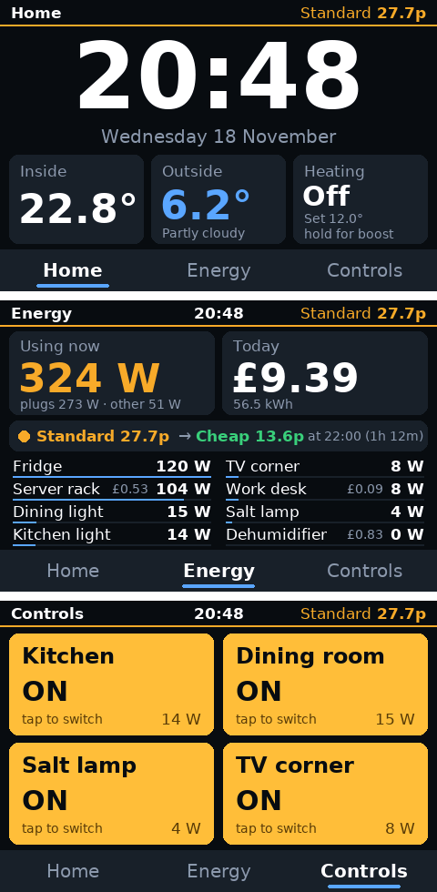

# CYD Home Panel

A small 3.5" touch screen that shows your **Home Assistant** home at a glance: the time, inside and outside
temperature, heating, live electricity use and cost, the current electricity price, and four buttons to switch lights
or plugs on and off.

It runs on a cheap ESP32-S3 3.5" "CYD" (Cheap Yellow Display) board. There is no soldering and no wiring: you plug it
into USB, load this program onto it once, and it talks to Home Assistant over your Wi-Fi.

**New to this? Follow the step-by-step guide: [docs/setup-guide.md](docs/setup-guide.md).** It assumes no experience
and takes about an hour, most of it waiting for downloads.

## What it shows

Swipe left or right, or tap the names at the bottom, to change page.

- **Home:** a big clock, the date, inside and outside temperature, the weather, and the heating.
  With Hive heating, **hold your finger on the Heating card** to boost the heating for 30 minutes (to the room
  temperature +1 °C, between 20 and 25 °C). Hold it again to stop the boost.
- **Energy:** how much power the whole house is using right now (split into "plugs" and "everything else"), today's
  cost and kWh, the current electricity price and when the next price starts, and your top 8 smart plugs by power.
- **Controls:** four big buttons. Tap one to switch that light or plug on or off.

Extras:

- **Price colours:** green = cheap, amber = standard, red = peak. The top line and the board's small LED show the
  current price. A chime plays when the peak price starts.
- **"HA offline" warning:** shown in red if Home Assistant stops answering for a minute.
- **Night mode:** the screen dims at night (23:00–07:00 by default). A touch wakes it for 30 seconds.
- **Optional "appliance stopped" alert:** a red banner and a chime when an appliance that should be running uses
  almost no power, for example a dehumidifier with a full tank.

## What you need

| | |
|---|---|
| Screen board | ESP32-S3 3.5" CYD touch board, ST77922, 320x480, with speaker (Amazon UK **B0HGQ5XMQ8**) |
| Cable | A USB-C cable that carries **data** (not a charge-only one) |
| Power | Any USB phone charger, once it is set up |
| Home Assistant | Already running on your home network |
| Optional | [Octopus Energy integration](https://github.com/BottlecapDave/HomeAssistant-OctopusEnergy) for prices and cost (the "using now" figure needs an Octopus Home Mini), Hive for the boost button, smart plugs that report power |

Anything you don't have is simply left blank in the settings, and that part of the screen stays empty.

## Settings

All your personal settings live in one file, `src/panel_settings.h`. You make it by copying
[`src/panel_settings.example.h`](src/panel_settings.example.h). It holds:

- your Wi-Fi name and password;
- your Home Assistant address and access token;
- the names of the Home Assistant entities to show;
- the price levels and the night-time hours.

`panel_settings.h` is listed in `.gitignore`, so it is never uploaded if you share your copy of this project.

## Safety notes

- The panel can only switch the four entities you put on the Controls page. Don't put a fridge, freezer or anything
  else that must stay on there.
- The alert entity is only watched, never switched.
- The access token lets the panel control Home Assistant. For extra safety you can create a separate, non-admin Home
  Assistant user just for the panel and make the token from that user ([guide, step 4](docs/setup-guide.md#4-get-the-details-from-home-assistant)).
- If you lose the board, delete its token in Home Assistant.

## For developers

- Build: `pio run`. Flash: `pio run -t upload`. Logs: `pio device monitor` (Wi-Fi, HA status and memory every 10 s).
- Data comes from the HA REST API. Each entity is read with `GET /api/states/<id>`: switches and power every 5 s,
  everything else every 30 s.
  - The websocket API is not used, because some Octopus sensors carry 3–4 KB attributes.
  - A filtered streaming parse of one entity at a time keeps memory use tiny.
- Bluetooth relays (for example SwitchBot) can take 5–40 s to react. A button shows "sending..." for up to 20 s
  until the new state arrives.
- **Screenshots over USB:** send `1`, `2` or `3` on the serial port to change page.
  - `tools/screenshot.py PORT out.png` (run with PlatformIO's Python, which has pyserial) saves the screen.
  - `tools/raw2png.py out.png.raw out.png` (needs Pillow) converts the raw dump.
- **Fonts:** pre-rendered anti-aliased DejaVu Sans, made by `tools/gen_fonts.py`.
- **Display, touch and audio drivers:** come from
  [DPFSentinel-ESP32-S3](https://github.com/vitorhpsousa/DPFSentinel-ESP32-S3), which also documents the board in
  detail.

## Licence

GPL-3.0 (see [LICENSE](LICENSE)), because the board drivers come from a GPL-3.0 project. The DejaVu fonts have their own
free licence; see [tools/fonts/README](tools/fonts/README).
